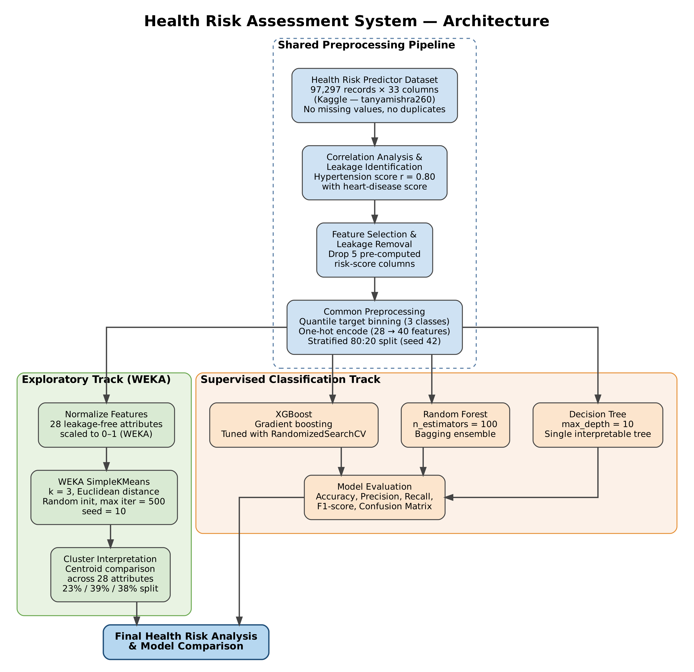
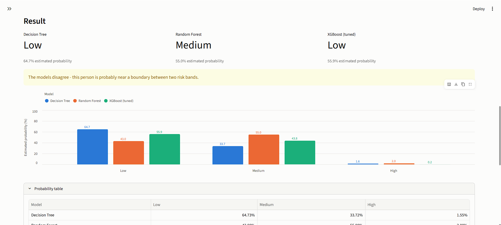
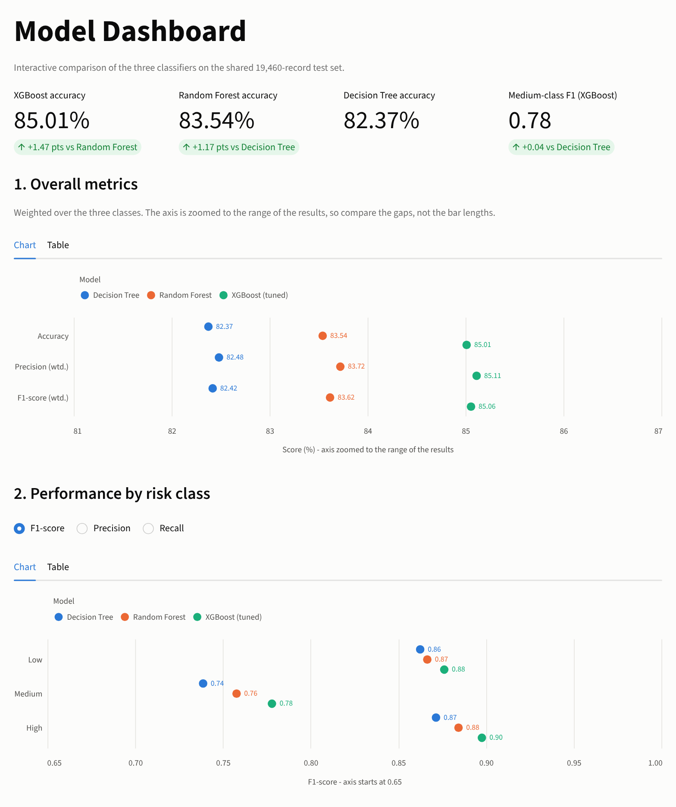

# Health Risk Assessment System

**Exploratory clustering with WEKA and heart-disease risk prediction using machine learning**

MCA mini project · TKM College of Engineering, Kollam

The project predicts a person's **heart-disease risk band (Low / Medium / High)** from 28 lifestyle and health
measurements, compares three classifiers on the same data split, and explores the same population with WEKA
K-Means clustering. A Streamlit web app lets anyone explore the results and try a live prediction.



## Results

All models use the same stratified 80:20 split (77,837 train / 19,460 test rows, `random_state=42`).

| Model | Accuracy | Precision (wtd.) | Recall (wtd.) | F1 (wtd.) |
|-------|---------:|-----------------:|--------------:|----------:|
| Decision Tree (`max_depth=10`) | 82.37 % | 82.48 % | 82.37 % | 82.42 % |
| Random Forest (100 trees) | 83.54 % | 83.72 % | 83.54 % | 83.62 % |
| **XGBoost (tuned)** | **85.01 %** | **85.11 %** | **85.01 %** | **85.06 %** |

Almost every mistake is between *neighbouring* bands (Low↔Medium, Medium↔High). Low↔High confusions are
at most 8 of 19,460 test rows. Details: [`results/`](results/).

> **Leakage note.** The dataset contains five pre-computed risk-score columns (e.g. `hypertension_risk_score`,
> correlation r = 0.80 with the target). They are removed before training so models learn from real
> measurements instead of reading the answer.

## Repository layout

```
Health-Risk-Assessment-ML/
├── app/                    Streamlit web app (9 pages, live predictor, in-app trainer)
│   ├── streamlit_app.py
│   ├── charts.py · results_data.py
│   └── assets/             images shown in the app
├── notebooks/              Google Colab notebooks, one per algorithm (see notebooks/README.md)
├── src/                    Shared code used by the app and the training script
│   ├── preprocessing.py    leakage removal, target binning, encoding, 80:20 split
│   ├── train_models.py     trains DT / RF / XGBoost and saves them to models/
│   └── prediction.py       loads models and predicts the risk for one person
├── results/                metrics (CSV) and figures: confusion matrices, importances, visualisations
├── docs/                   project report (PDF), methodology, architecture, app screenshots
├── data/                   dataset goes here (not committed) – see data/README.md
├── requirements.txt
├── CONTRIBUTING.md         how the team works together on GitHub
└── LICENSE
```

## Quick start

```bash
git clone https://github.com/Midhunm107/Health-Risk-Assessment-ML.git
cd Health-Risk-Assessment-ML

python -m venv .venv
.venv\Scripts\activate            # Windows   (Linux/macOS: source .venv/bin/activate)
pip install -r requirements.txt
```

1. Put the dataset at `data/health_risk_predictor.csv` (see [`data/README.md`](data/README.md)).
2. Train and save the three models (about a minute):

   ```bash
   python -m src.train_models data/health_risk_predictor.csv
   ```

3. Start the app:

   ```bash
   streamlit run app/streamlit_app.py
   ```

Skipping step 2 is fine too: open **Live Risk Predictor**, upload the CSV and click *Train the three models now*.

### Notebooks

Open the files in [`notebooks/`](notebooks/) in Google Colab, upload the dataset when asked, and run all cells.

## Web app pages

Overview · Dataset and Preprocessing · Architecture · Model Results · Model Dashboard · WEKA Clustering ·
Data Explorer · Live Risk Predictor · Team. Screenshots are in [`docs/screenshots/`](docs/screenshots/).

| Live predictor | Model dashboard |
|---|---|
|  |  |

## Documentation

- [`docs/project_report.pdf`](docs/project_report.pdf) – full project report
- [`docs/methodology.md`](docs/methodology.md) – data preparation, models and evaluation in brief

## Team

| Name | Roll no. |
|------|----------|
| Adithya Dev | 25MCA005 |
| Midhun M. Pillai | 25MCA035 |
| Joyal John Mathew | 25MCA028 |

Working agreements, branch names and the review process are in [`CONTRIBUTING.md`](CONTRIBUTING.md).

## License

Released under the [MIT License](LICENSE).
